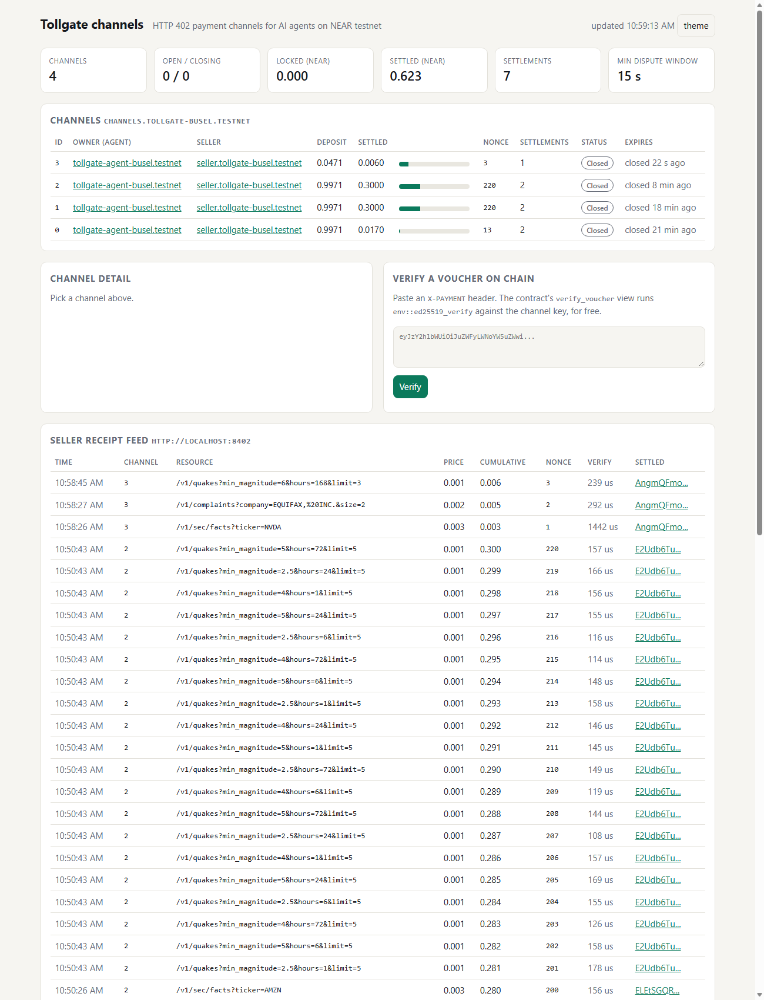

# Tollgate

**HTTP 402 micropayment channels for AI agents on NEAR.** An agent locks a budget once, then
pays every API call with an off-chain signed voucher that the seller checks in microseconds.
The seller cashes the newest voucher on chain whenever it likes (one transaction for hundreds
or thousands of calls), and the agent can always take back whatever it did not spend.

Built for the NEAR Hackathon (tracks: `agents`, `realworld`) by Matthew Busel (Tensorust LLC).
All code in this repository was written during the hackathon window.

**Try it live (NEAR testnet):**
- Paid API: https://near-tollgate.vercel.app (an unpaid `curl -i https://near-tollgate.vercel.app/v1/quakes` returns the HTTP 402 offer; `npm run tollgate -- fetch https://near-tollgate.vercel.app/v1/quakes` pays it with a voucher once you have testnet accounts from `npm run setup`).
- Dashboard: https://near-tollgate.vercel.app/dashboard/ (channels from NEAR RPC plus the seller's receipt feed).
- Demo video: https://youtu.be/RItnCVGQ_2s

> The author's other NEAR Hackathon project (rule Q-015) is
> **Leash, on-chain spending policy wallet for AI agents (https://github.com/Mattbusel/leash)**.
> The two are independent: Leash decides *whether* an agent may pay; Tollgate makes paying
> per call cheap and fast. Earlier prior art by the same author, [agenttab](https://github.com/Mattbusel/agenttab),
> is a PayPal-based tab for agents; no code was reused.

| | |
| --- | --- |
| Contract (testnet) | [`channels.tollgate-busel.testnet`](https://testnet.nearblocks.io/address/channels.tollgate-busel.testnet) |
| Demo seller | [`seller.tollgate-busel.testnet`](https://testnet.nearblocks.io/address/seller.tollgate-busel.testnet) |
| Demo agent | [`tollgate-agent-busel.testnet`](https://testnet.nearblocks.io/address/tollgate-agent-busel.testnet) |
| Deploy tx | [`FHcP4UiVCR93FzGL7QGWctz4tQQYb4U9JRQNmAQew6Jx`](https://testnet.nearblocks.io/txns/FHcP4UiVCR93FzGL7QGWctz4tQQYb4U9JRQNmAQew6Jx) |
| Code hash | `2ANyRzxbZF3mXMpp5EqwDUWq6DoeuyPCDnYHcRKQmQqj` = base58(sha256(`res/tollgate_channels.wasm`)) |
| Latest demo run | [`demo/demo-latest.txt`](demo/demo-latest.txt) (full log) and [`demo/demo-latest.json`](demo/demo-latest.json) (every tx hash) |

## Measured on testnet (latest `npm run demo`)

One channel, 1 NEAR deposit, 220 paid calls to a live data API (USGS, CFPB, SEC EDGAR), then
the same 200 calls paid the old way, one NEAR transfer each. Every number below is measured
from real testnet transactions in that run.

| | Tollgate channel | Per-call transfers |
| --- | --- | --- |
| On-chain transactions for 200 paid calls | **0** (agent and seller access key nonces unchanged) | 200 |
| Payment latency per call | **7 ms** median, including the HTTP round trip and the upstream API | 1,997 ms median |
| Seller-side check per call | ed25519 voucher verify, **160 microseconds** median | wait for a block |
| Gas to settle 200 calls | **3.228 Tgas** (1 `settle` tx) | 89.273 Tgas (27.7x more) |
| Gas for the whole lifecycle (open, 2 settlements, start_close, finalize; 220 calls) | 14.073 Tgas (5 txs) | 89.273 Tgas for 200 calls (6.3x more) |
| Money spent on chain costs | 0.001229 NEAR tx fees + 0.0029 NEAR channel storage = 0.004128 NEAR | 0.008927 NEAR |

Break-even is about 93 calls per channel (mostly the one-time storage staking of the channel
record); past that, extra calls add no chain cost until the next settlement.

Transactions from that run (all on [testnet.nearblocks.io](https://testnet.nearblocks.io/address/channels.tollgate-busel.testnet)):

| Step | Result | Transaction |
| --- | --- | --- |
| Agent hits 402, client opens channel 2 with 1 NEAR | OK | [`CNe7RjDE...`](https://testnet.nearblocks.io/txns/CNe7RjDEN4aL6Y4sywRtEA7wnMSHDWj86EcxmqhWD9Ka) |
| 200 paid calls | 0 transactions | (vouchers only) |
| Seller settles 0.28 NEAR at nonce 200 | OK | [`ELEtSGQR...`](https://testnet.nearblocks.io/txns/ELEtSGQRPBE49JPi7bC65djfcKH6jGFZawg4UaUjpzgQ) |
| Seller replays the settled voucher | `TOLLGATE_REPLAY` | [`A5nsLktK...`](https://testnet.nearblocks.io/txns/A5nsLktKjRWFwhP2b761hn2zV4w2VxrKBbm9GkPdJtCK) |
| Seller forges a bigger amount with the old signature | `TOLLGATE_BAD_SIGNATURE` | [`3dgSR5NY...`](https://testnet.nearblocks.io/txns/3dgSR5NYsTZGLTmwsRRNzZbx7ePimQmmWxPJ3r8jrTAj) |
| Signed voucher for more than the deposit | `TOLLGATE_OVERSPEND` | [`DenywqU8...`](https://testnet.nearblocks.io/txns/DenywqU8TKGC6CSgv2M5SHvPPvGGDrDiZRCwYi4JSAkJ) |
| 20 more calls, then the agent starts a unilateral close | OK | [`96WmaxiG...`](https://testnet.nearblocks.io/txns/96WmaxiGaWi555Sym7P4hXW3tNQTqfL9hLd12DY7pDJi) |
| Agent tries to finalize inside the dispute window | `TOLLGATE_DISPUTE_WINDOW` | [`317b82fu...`](https://testnet.nearblocks.io/txns/317b82fusRoF679rsvZAasWCFS8tEJiMsKojs9YHf6Au) |
| Seller's settler notices the close and settles the last 20 calls inside the window | OK | [`E2Udb6Tu...`](https://testnet.nearblocks.io/txns/E2Udb6TuoCfMXptfzf6NbAHWVY85qQNVhtEunRQ6FnDt) |
| Agent finalizes after the window: 0.6971 NEAR refunded | OK | [`FZX41mPT...`](https://testnet.nearblocks.io/txns/FZX41mPThX1ZuZ2Bb3gSaoHAfRas4cQi6ZCUnSFfSqtZ) |
| Baseline transfer (one of 200) | OK | [`J5Kjp1Nt...`](https://testnet.nearblocks.io/txns/J5Kjp1NtTnqKJX4k4rjnTVKrALCnpgsZF9hKtM2TLrC7) |

Balances: the seller earned exactly 0.300000 NEAR for 220 calls, the agent got 0.697100 NEAR
back, and the contract kept the 0.0029 NEAR storage fee. The agent's receipt log maps 200
receipts to the first settlement and 20 to the second.

## The problem

More and more APIs want to charge agents per call: a search, a data lookup, a model call,
often for a tenth of a cent. HTTP 402 ("Payment Required") is the natural place to ask for
the money, and x402 made it popular. But each answer to a 402 today is either

- **a custodial tab or card** on file with the seller (the agent's owner trusts the seller, and
  the seller has to trust the owner to pay the bill later), or
- **one on-chain transaction per call**, which costs more than the call is worth and adds a
  block of latency to every request.

Tollgate is the third option: a unidirectional payment channel per agent and seller. Trust
is enforced by the NEAR contract, the per-call cost is a signature check, and the chain sees
three to five transactions per channel instead of one per request.

## How it works

```
  agent (Node lib / CLI / MCP)                 seller (any HTTP API + Tollgate SDK)
  ---------------------------                  ------------------------------------
  1. GET /v1/quakes          ----------------> no voucher
                             <---------------- 402 {scheme:"near-channel", price, contract, payTo}
  2. open_channel(seller, channel_pubkey)  ==> channels contract on NEAR (1 tx, locks the budget)
  3. GET /v1/quakes
     X-PAYMENT: voucher #1   ----------------> ed25519 verify (~0.2 ms), keep newest voucher
                             <---------------- 200 + data + X-PAYMENT-RESPONSE
     ... calls 2..N, one voucher each, zero transactions ...
                                               4. settle(newest voucher) ==> contract pays the
                                                  seller the delta (1 tx for all N calls)
  5. start_close ==> contract                     seller may still settle during the window
  6. finalize    ==> contract refunds the unspent rest to the agent
```

- **Contract** (`contracts/channels`, Rust, near-sdk 5.30): holds deposits, verifies vouchers
  with `env::ed25519_verify`, pays sellers, refunds owners. JSON events in NEP-297 format.
- **Seller SDK** (`src/seller/tollgate.mjs`): `gate.protect({ price }, handler)` wraps any
  `node:http` handler. No voucher, or a bad one, means HTTP 402 with machine-readable payment
  instructions. A settler loop cashes vouchers every N calls or T seconds, and immediately when
  an agent starts closing a channel.
- **Demo paid API** (`server/`): live, keyless U.S. public data. USGS earthquakes (0.001 NEAR),
  CFPB consumer complaints (0.002 NEAR), SEC EDGAR XBRL company financials (0.003 NEAR).
  Runs on `node:http` locally and as a Vercel function (`api/index.mjs`).
- **Agent client** (`src/agent/`): a `fetch()` that pays 402s automatically, a CLI, and an MCP
  server (stdio) so Claude Code, Codex or any MCP client gets paid tools. The human sets the
  budget, the per-call price cap and the trusted contract; the model never sees a key.
- **Dashboard** (`dashboard/`): static page reading channel state from public testnet RPC,
  plus the seller's receipt feed, plus an on-chain voucher checker.



## Voucher format

A voucher is this UTF-8 string, signed with ed25519 by the channel's dedicated key:

```
tollgate:v1:<contract_id>:<channel_id>:<cumulative_yocto>:<nonce>

e.g. tollgate:v1:channels.tollgate-busel.testnet:1:280000000000000000000000:200
```

| Field | Meaning |
| --- | --- |
| `tollgate:v1` | Domain separator and version. A Tollgate signature can never be replayed as anything else, and the close-request message uses a different prefix (`tollgate:v1:close:<contract>:<channel_id>`). |
| `contract_id` | The channels contract account. Binds the voucher to one deployment and one network (`.testnet` vs `.near`). |
| `channel_id` | Decimal u64. Binds it to one agent, one seller and one deposit. |
| `cumulative_yocto` | Decimal u128: the **total** the agent has agreed to pay on this channel so far, not the price of this call. A newer voucher supersedes all older ones, so the seller only ever needs to keep one. |
| `nonce` | Decimal u64, strictly increasing (one per call). |

Account ids cannot contain `:`, so the encoding is unambiguous. The contract rebuilds the same
string (`voucher_message` view) and checks it with `env::ed25519_verify` against the channel
key stored at `open_channel`. The signature travels base64-encoded. A cross-language test
vector (`test/vectors/`) is checked by both the Rust and the Node test suites.

### The 402 handshake

Without a voucher the seller answers (shape modelled on x402, new scheme name):

```http
HTTP/1.1 402 Payment Required
x-tollgate-scheme: near-channel
x-tollgate-network: near-testnet
x-tollgate-contract: channels.tollgate-busel.testnet
x-tollgate-seller: seller.tollgate-busel.testnet
x-tollgate-price: 1000000000000000000000

{
  "x402Version": 1,
  "error": "payment required",
  "accepts": [{
    "scheme": "near-channel",
    "network": "near-testnet",
    "maxAmountRequired": "1000000000000000000000",
    "asset": "NEAR",
    "payTo": "seller.tollgate-busel.testnet",
    "resource": "http://127.0.0.1:8402/v1/quakes?min_magnitude=5",
    "description": "Recent earthquakes worldwide from the USGS FDSN event API",
    "mimeType": "application/json",
    "maxTimeoutSeconds": 60,
    "extra": {
      "contract": "channels.tollgate-busel.testnet",
      "price": "1000000000000000000000",
      "priceNear": "0.001",
      "voucher": "tollgate:v1:{contract}:{channel_id}:{cumulative_yocto}:{nonce}",
      "signature": "ed25519 over the UTF-8 voucher string, base64, made with the channel key",
      "header": "X-PAYMENT",
      "headerFormat": "base64(JSON {scheme, network, payload:{contract, channel_id, cumulative, nonce, signature}})",
      "minDisputeWindowSec": 15,
      "minRemainingSec": 120,
      "openChannel": { "contract": "...", "method": "open_channel", "args": { "seller": "...", "agent_pubkey": "ed25519:<channel public key>", "expires_in_sec": "86400", "dispute_window_sec": "15" } }
    }
  }]
}
```

The agent retries with `X-PAYMENT: base64({"scheme":"near-channel","network":"near-testnet","payload":{"contract":"...","channel_id":"1","cumulative":"...","nonce":"7","signature":"<base64>"}})`.
The seller checks, in order: right contract and network, channel exists on chain and pays this
seller, channel is `Open` with enough time left and a long enough dispute window, nonce above
the newest one it holds, cumulative grew by at least the price, cumulative within the deposit,
signature valid. On success it answers `200` with an `X-PAYMENT-RESPONSE` header (base64 JSON:
channel, cumulative, nonce, and the latest settlement tx once there is one). Refusals are `402`
with `extra.reason` (`stale_nonce`, `underpaid`, `overspend`, `bad_signature`, `wrong_contract`,
`channel_not_open`, `channel_expiring`, ...).

## Contract API

| Method | Who | What |
| --- | --- | --- |
| `new(min_dispute_window_sec, max_expiry_sec)` | init | Testnet deployment uses 15 s and 30 days. |
| `open_channel(seller, agent_pubkey, expires_in_sec, dispute_window_sec?)` payable | agent | Locks the attached NEAR minus the measured storage cost of the record. `agent_pubkey` must be ed25519. Returns the channel id. |
| `top_up(channel_id, extend_expiry_sec?)` payable | owner | Adds deposit, optionally extends expiry. |
| `settle(channel_id, cumulative_amount, nonce, signature)` | seller | Verifies the voucher on chain, pays `cumulative - settled`. |
| `cooperative_close(channel_id, cumulative_amount?, nonce?, signature?)` | seller | Optional final settle, then refunds the rest to the owner at once. The SDK does this when the agent posts a close request signed by its channel key to `POST /tollgate/close`. |
| `start_close(channel_id)` | owner | Starts the dispute window. The seller can still settle until it ends. |
| `finalize(channel_id)` | anyone | After the window (or after expiry) refunds `deposit - settled` to the owner. |
| `get_channel`, `get_channels`, `get_channels_for(account)`, `get_stats`, `get_config` | view | Channel state, settle deadline, totals. |
| `voucher_message(channel_id, cumulative_amount, nonce)`, `verify_voucher(...)` | view | The exact bytes to sign, and a free on-chain signature check. |

Errors are panics with stable codes: `TOLLGATE_BAD_SIGNATURE`, `TOLLGATE_REPLAY`,
`TOLLGATE_OVERSPEND`, `TOLLGATE_STALE_AMOUNT`, `TOLLGATE_SETTLE_WINDOW_OVER`,
`TOLLGATE_DISPUTE_WINDOW`, `TOLLGATE_NOT_CLOSABLE`, `TOLLGATE_NOT_SELLER`, `TOLLGATE_NOT_OWNER`,
`TOLLGATE_NOT_OPEN`, `TOLLGATE_CLOSED`, `TOLLGATE_BAD_WINDOW`, `TOLLGATE_BAD_EXPIRY`,
`TOLLGATE_DEPOSIT_TOO_SMALL`, `TOLLGATE_BAD_KEY`, `TOLLGATE_BAD_SELLER`, `TOLLGATE_NO_CHANNEL`.

Events (`EVENT_JSON:{"standard":"tollgate","version":"1.0.0","event":...}`): `channel_opened`,
`channel_topped_up`, `channel_settled`, `channel_close_started`, `channel_closed`.

Timing rule: the seller may settle while `now < expires_at` and, once closing, while
`now < close_requested_at + dispute_window`. `finalize` is allowed exactly when settling is
not. So an agent can never pull its deposit out from under a voucher the seller is still
allowed to cash, and a seller can never hold the agent's money past the window or the expiry.

## Run it ("do X, see Y")

Prerequisites: Node 20 or newer. Rust is only needed to rebuild the contract or run the Rust
tests (the toolchain file pins 1.99.0 with `wasm32-unknown-unknown`; near-sdk 5.30 needs 1.95+).
The built contract is committed at `res/tollgate_channels.wasm`.

```sh
npm install
```

| Do | See |
| --- | --- |
| `npm run test:node` | `# tests 22`, `# pass 22`: voucher encoding and the cross-language vector, the 402 handshake, replay/underpay/overspend/tamper refusals, settler behaviour, cooperative close authorisation, budget and price caps. No network. |
| `cargo test` (or `npm run test:rust`) | `test result: ok. 18 passed`: voucher verification, replay, overspend, stale amount, domain separation, dispute window, expiry, close/refund, cooperative close, auth, views. Uses `testing_env!`, no sandbox. |
| `npm run demo` | The full loop on NEAR testnet (about 8 to 10 minutes, most of it the 200-transfer baseline). On a fresh clone it first creates your own accounts with the public testnet faucet and deploys your own copy of the contract (`deployments/testnet.local.json`). Then: 402, `open_channel` tx, 200 paid calls with `+0 transactions`, one `settle` tx, three attacks rejected on chain (`TOLLGATE_REPLAY`, `TOLLGATE_BAD_SIGNATURE`, `TOLLGATE_OVERSPEND`), unilateral close with `TOLLGATE_DISPUTE_WINDOW` on an early finalize, a seller settlement inside the window, the refund, balances, the 200-transfer baseline and the cost table. Every tx is printed as a `https://testnet.nearblocks.io/txns/<hash>` link. Shorter: `npm run demo -- --calls 50 --baseline 20`. |
| `npm run seller` then `curl -i http://127.0.0.1:8402/v1/quakes` | `HTTP/1.1 402 Payment Required` with the JSON above. `curl http://127.0.0.1:8402/` lists the products for free. |
| with the seller running: `npm run tollgate -- fetch "http://127.0.0.1:8402/v1/sec/facts?ticker=NVDA"` | NVIDIA's latest 10-K revenue, net income, assets from SEC EDGAR, and on stderr `paid 0.003000 NEAR to seller... No on-chain transaction for this call.` The first call opens a channel (one tx). Then `npm run tollgate -- receipts` and `npm run tollgate -- status`. `npm run tollgate -- close <channel_id>` asks the seller to settle and refund at once (a `cooperative_close` tx, for example [`AngmQFmo...`](https://testnet.nearblocks.io/txns/AngmQFmoCKGHcEN8LFb9iZuKRK5kaJVvGbN3vMqzvbPT), which settled 3 calls and refunded 0.0411 NEAR). |
| `npm run dashboard` and open http://127.0.0.1:8403 | Live channels from testnet RPC with settled/deposit bars, channel detail, the seller receipt feed (when `npm run seller` is up) and an on-chain voucher checker. |
| `node scripts/mcp-smoke.mjs http://127.0.0.1:8402/v1/quakes` | Starts the MCP server over stdio like Claude Code would, lists `tollgate_fetch, tollgate_status, tollgate_receipts, tollgate_close_channel`, makes one paid call and prints the receipt. |

The CLI, MCP server and seller pick up the accounts and keys that `npm run setup` (also run by
the demo) wrote to `.env.testnet` (gitignored). Nothing secret is ever printed.

### Use it from Claude Code (MCP)

```sh
claude mcp add tollgate \
  -e TOLLGATE_BUDGET_NEAR=0.5 -e TOLLGATE_MAX_PRICE_NEAR=0.005 \
  -- node /absolute/path/to/tollgate/src/agent/mcp.mjs
```

Then ask: "Use tollgate_fetch on http://127.0.0.1:8402/v1/complaints?company=EQUIFAX,%20INC. and
summarise the newest complaints, then show my receipts." The agent pays 0.002 NEAR per call from
a channel, cannot exceed 0.005 NEAR per call or 0.5 NEAR in total, and cannot lock funds in any
contract other than the trusted one.

Agent configuration (environment): `TOLLGATE_ACCOUNT_ID`, `TOLLGATE_ACCOUNT_KEY` (default: the
demo agent from `.env.testnet`), `TOLLGATE_BUDGET_NEAR` (default 1), `TOLLGATE_MAX_PRICE_NEAR`
(0.01), `TOLLGATE_CHANNEL_NEAR` (deposit per channel, default the budget), `TOLLGATE_CONTRACTS`
(trusted contracts), `TOLLGATE_DISPUTE_WINDOW_SEC` (60), `TOLLGATE_STATE_DIR` (`.tollgate/`).

Seller configuration: `PORT` (8402), `TOLLGATE_CONTRACT`, `TOLLGATE_SELLER`,
`TOLLGATE_SELLER_KEY`, `TOLLGATE_STORE` (`state/seller.json`), `SETTLE_EVERY_CALLS` (100),
`SETTLE_EVERY_SEC` (60), `MIN_DISPUTE_WINDOW_SEC` (15), `SEC_USER_AGENT`.

### Selling your own endpoint

```js
import http from 'node:http';
import { createTollgate } from './src/seller/tollgate.mjs';
import { FileStore } from './src/seller/store.mjs';
import { sellerChain } from './server/chain.mjs';

const chain = sellerChain({ accountId: 'me.testnet', privateKey: process.env.KEY, contract: 'channels.tollgate-busel.testnet' });
const gate = createTollgate({
  contract: 'channels.tollgate-busel.testnet', seller: 'me.testnet',
  store: new FileStore('state/me.json'), settle: chain.settle, cooperativeClose: chain.cooperativeClose,
});
http.createServer(gate.protect({ price: '0.001' }, (req, res) => res.end('{"answer":42}'))).listen(8080);
gate.startSettler();
```

### Deploying the paid API to Vercel

`api/index.mjs` + `vercel.json` route `/`, `/v1/*` and `/tollgate/*` to the same handler; the
dashboard is served statically at `/dashboard/` and reads the receipt feed from the same origin.
Set `TOLLGATE_CONTRACT`, `TOLLGATE_SELLER`, `TOLLGATE_SELLER_KEY` and `CRON_SECRET`. Settlement
runs from a Vercel cron hitting `/tollgate/settle` (daily on the Hobby plan; call it more often
from anywhere with `Authorization: Bearer $CRON_SECRET`). See Limitations about storage.

## How NEAR fits, concretely

- **`env::ed25519_verify` on chain.** The contract checks the agent's voucher signature itself,
  so the seller needs no trust in the agent and the agent needs no trust in the seller. The same
  host function powers the free `verify_voucher` view the dashboard uses.
- **Cheap, fast settlement.** One `settle` burns about 3.2 Tgas (about 0.00028 NEAR) and is
  final in seconds, whether it covers 2 calls or 2,000. A plain transfer costs about 0.45 Tgas,
  so a channel pays for itself after a handful of calls.
- **Named accounts.** The 402 says `payTo: seller.tollgate-busel.testnet` and
  `contract: channels.tollgate-busel.testnet`: humans and agents can read who they pay and
  which contract holds the money, and the agent pins trusted contracts by name.
- **Access keys and key separation.** The channel key is a fresh ed25519 key that controls no
  account; leaking it can at most spend what is left in that one channel. The account key is
  used only to open, top up and close. With [Leash](https://github.com/Mattbusel/leash) the
  account key itself can be a function-call key scoped by an on-chain policy.
- **Storage staking.** The channel record's storage (290 bytes, 0.0029 NEAR) is measured with
  `env::storage_usage` at open and charged to the opener, so the contract cannot be drained by
  spam channels.
- **NEP-297 events** make every open, settlement and close indexable by explorers and indexers.

## Security notes

- The seller can only ever receive what the agent signed, capped by the deposit. Replays,
  forged amounts, lower amounts and overspends are rejected by the contract (and earlier by
  the SDK).
- The agent client refuses to lock funds in a contract that is not on its trusted list, so a
  malicious 402 cannot point it at a contract that steals deposits. It also refuses calls above
  the per-call cap or past the total budget (`spent + unspent deposits + channel storage fees <= budget`), persists every
  voucher before sending it (no nonce reuse after a crash), rolls back vouchers the seller
  refused, and only adopts a higher nonce from the seller, never a higher amount.
- The seller persists the newest voucher before answering, settles automatically when it sees
  a channel closing, and refuses channels whose expiry or dispute window is too short for it.

## Limitations (honest list)

- **NEAR only.** NEP-141 tokens (for example testnet USDC) were a stretch goal and are not
  implemented; the channel and voucher design carry over directly (`ft_on_transfer` to open,
  `ft_transfer` to pay out).
- **Testnet dispute window is short (15 s minimum)** so the demo can show a whole close in a
  minute. A production deployment should use hours; sellers already enforce their own minimum.
- **The channel's storage fee (0.0029 NEAR) is kept** by the contract after close; closed
  channels stay readable for the dashboard. Deleting closed records and refunding storage is a
  small follow-up.
- **Seller state is a JSON file.** On Vercel `/tmp` is per instance and not durable, so a cold
  start can lose unsettled vouchers (lost revenue for the seller, never extra cost for the
  agent). Production sellers should plug a durable store (four methods, see `src/seller/store.mjs`).
- **One channel per agent and seller at a time**, calls on it are serialised by the client.
  Concurrent calls to the same seller queue for a few milliseconds each.
- **Builds are non-reproducible** (`cargo near build non-reproducible-wasm --no-abi`); the ABI
  step links a native library that fails on Windows. `near-workspaces` sandbox tests do not run
  on Windows, so contract tests use `testing_env!` unit tests and the demo runs on real testnet.
- The demo baseline sends real transfers sequentially to measure latency honestly; it is the
  slowest part of the demo by design.

## Repository map

| Path | What |
| --- | --- |
| `contracts/channels/src/lib.rs` | The channels contract |
| `contracts/channels/src/tests.rs` | 18 Rust unit tests |
| `src/core/voucher.mjs` | Voucher format, ed25519 keys, X-PAYMENT header (node:crypto only) |
| `src/core/near.mjs` | RPC, transactions, gas and fee accounting (near-api-js) |
| `src/seller/tollgate.mjs`, `store.mjs` | Seller SDK: 402, verification, settler, cooperative close |
| `server/` | Demo paid API (USGS, CFPB, SEC EDGAR) and its chain adapter |
| `api/index.mjs`, `vercel.json` | Vercel deployment of the same API |
| `src/agent/client.mjs`, `cli.mjs`, `mcp.mjs`, `config.mjs` | Agent library, CLI, MCP server |
| `dashboard/` | Static dashboard (no build step) |
| `scripts/setup.mjs`, `demo.mjs`, `build.mjs`, `serve-dashboard.mjs`, `mcp-smoke.mjs` | Setup, end-to-end demo, build, tools |
| `test/` | Node tests and the shared test vector |
| `deployments/testnet.json` | Reference deployment ids and setup txs |
| `res/tollgate_channels.wasm` | The deployed contract build |

## Libraries used

- [near-sdk](https://crates.io/crates/near-sdk) 5.30 (contract; `unit-testing` feature for tests)
- [ed25519-dalek](https://crates.io/crates/ed25519-dalek) 2 (Rust tests only, to sign vouchers)
- [cargo-near](https://github.com/near/cargo-near) 0.22 (wasm build)
- [near-api-js](https://www.npmjs.com/package/near-api-js) 7.4.0 (transactions from Node)
- [@modelcontextprotocol/sdk](https://www.npmjs.com/package/@modelcontextprotocol/sdk) 1.32.2 and [zod](https://www.npmjs.com/package/zod) 4 (MCP server)
- Node built-ins: `node:crypto` (ed25519), `node:http`, `node:test`
- Public services: NEAR testnet RPC (FastNEAR, rpc.testnet.near.org), the NEAR testnet faucet
  helper, testnet.nearblocks.io; data from the USGS FDSN event API, the CFPB Consumer Complaint
  Database API and the SEC EDGAR XBRL API (all keyless).

## License

MIT, Copyright (c) 2026 Matthew Busel. See [LICENSE](LICENSE).
